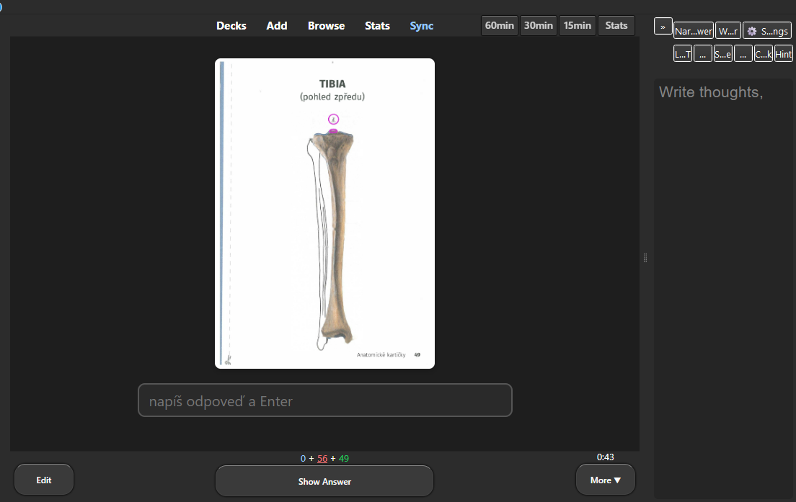
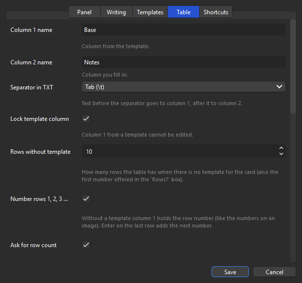

<p align="center"></p>

# Notepad by AnkiMonkey 🐒

A simple scratchpad panel next to your card in the Anki reviewer. Write down your thoughts, reasoning or a quick answer before you flip the card. That's it, nothing else.



* **Text mode:** a free scratchpad.
* **Table mode:** two columns (*Base* / *Notes*), with numbered rows or rows from a TXT template.
* 100 % local. No account, no cloud, no internet.

## Install

* **From file:** Tools → Add-ons → Install from file → `notepad.ankiaddon` (build it with `python build.py`).
* **By hand:** copy this folder into `%APPDATA%\Anki2\addons21\` and restart Anki.

Needs Anki 23+ (Qt6).

## Shortcuts

| Shortcut | Action |
|---|---|
| `Alt+N` | collapse / expand the panel |
| `Alt+P` | jump into the panel (`Esc` = back to the card) |
| `Alt+M` | text ↔ table mode |
| `Alt+I` | load a TXT template |
| `Alt+W` | save the current text / Base column as the template for this card (old file kept as `.bak`) |
| `Alt+.` / `Alt+,` | wider / narrower |
| `Alt+S` | settings (every option explained) |

Typing in the panel never triggers Anki review keys (Enter, Space, 1–4).
In the table: **Enter** = next row (adds one at the end), **Tab** = next cell, **Esc** = back to the card.

## Templates

Put TXT files into `user_files/templates/` (or pick another folder in Settings). For every card the first match wins:

1. **Tag rules** from Settings, e.g. `Pharma → pharma.txt` (matches `Pharma`, `Pharma::Antibiotics` …)
2. **Tags**, most specific first: `Pharma::Antibiotics` → `Pharma__Antibiotics.txt`, then `Pharma.txt`
3. **Deck**: `Med::Micro` → `Med__Micro.txt`, then `Med.txt`
4. `default.txt`

For the table, one line = one row; text before the tab goes to column 1, after it (optional) to column 2. Examples: `user_files/templates/_example_*.txt`.

Without a template, table mode asks **Rows?** on each card: type a number + Enter (Esc keeps the current rows).

## Settings

⚙ in the panel or `Alt+S`. The raw JSON is in Tools → Add-ons → Notepad → Config (explained in `config.md`).



## Files

```
__init__.py      the whole add-on
config.json / config.md / manifest.json / logo.png
build.py         builds notepad.ankiaddon
user_files/      your templates (kept when the add-on updates, never committed)
```

## License

Free to use. Made by AnkiMonkey.
